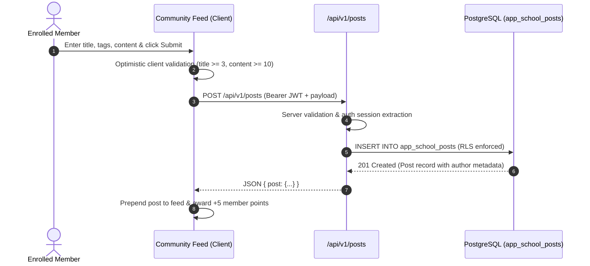

# Technical Architecture — AKSchool

> System Architecture, Component Topology, and Data Flows for **AKSchool (CommunityOS)**

---

## 1. High-Level System Architecture

```mermaid
graph TD
    Client[Web Browser Desktop / Mobile] -->|HTTPS| Traefik[Traefik Edge Reverse Proxy]
    Traefik -->|Port 3000| NextApp[Next.js 15 Standalone Container]
    
    subgraph "Next.js Application Architecture"
        NextApp --> AppRouter[App Router Layout & Pages]
        NextApp --> ServerActions[API Routes /api/v1/*]
        NextApp --> AIEndpoint[/api/ai/chat]
        NextApp --> HealthCheck[/api/health]
    end
    
    subgraph "External & Persistence Layer"
        ServerActions -->|PostgreSQL 5432 / REST| SupabaseDB[(PostgreSQL - app_school_* with RLS)]
        AIEndpoint -->|HTTPS POST| MiMoAPI[Xiaomi MiMo API Gateway]
    end
```

---

## 2. Component Boundaries & Routing Topology

| Route | View Component | Access Role | Description |
|---|---|---|---|
| `/` | `LandingView` | Public | Hero showcase, features breakdown, interactive pricing tiers, community stats. |
| `/login` | `LoginView` | Public | Email/password auth, role-switcher demo buttons, session initialization. |
| `/community` | `CommunityView` | Member | Space tabs, post feed, rich markdown creator, comment threads, like reactions. |
| `/classroom` | `ClassroomView` | Member | Course grid, tiered access gate, video embed player, markdown curriculum reader, progress tracker. |
| `/members` | `MembersView` | Member | Real-time searchable directory, gamified point badges, profile modals. |
| `/admin` | `AdminView` | Instructor / Admin | Space authoring, course module/lesson manager, AI knowledge base upload, plan toggles. |
| `/platform` | `PlatformView` | Superadmin | Cross-tenant metrics, server health status, AI token consumption telemetry. |
| `/api/health` | `HealthRoute` | Public / DevOps | Automated liveness and readiness probe for container orchestration. |

---

## 3. Data Flow: Community Discussion Workflow



---

## 4. Multi-Tenant Database Isolation Model

1. **Table Namespacing:** All database tables for this project are prefixed with `app_school_*`.
2. **PostgreSQL Row-Level Security:**
   - Every table enables RLS: `ALTER TABLE app_school_* ENABLE ROW LEVEL SECURITY;`
   - Every policy verifies tenant ownership:
     ```sql
     CREATE POLICY "school_member_isolation" ON app_school_posts
     FOR ALL TO authenticated
     USING ((auth.jwt() -> 'user_metadata' ->> 'app') = 'school');
     ```
3. **Admin Elevation:**
   - The platform superadmin (`admin@akstack.com` with role `superadmin`) bypasses single-tenant restrictions to monitor cross-platform health.
