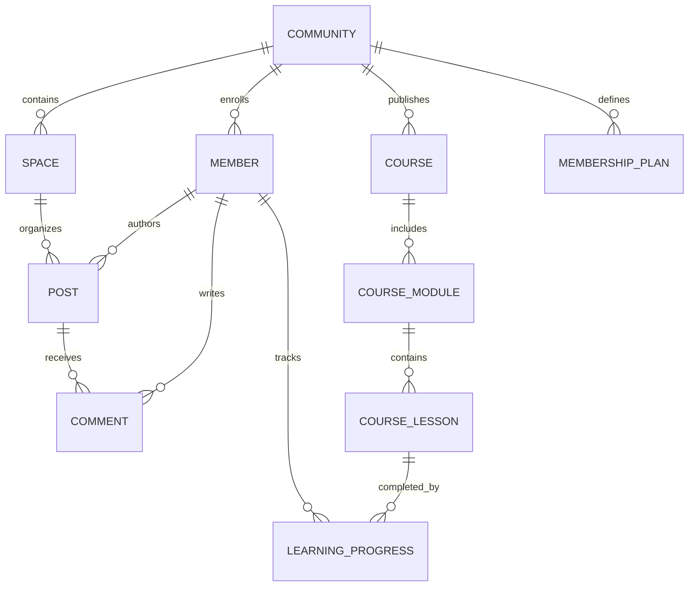

# Data Model Specification — AKSchool

> Relational Schemas, Constraints, Indexes, and Security Policies for **AKSchool (CommunityOS)**

---

## 1. Schema Entity Relationship Diagram

---

## 2. Table Specifications (`app_school_*`)

### `app_school_communities`
Stores community brand metadata and settings.
| Column | Type | Constraints | Description |
|---|---|---|---|
| `id` | `UUID` | PRIMARY KEY, DEFAULT `gen_random_uuid()` | Unique community identifier |
| `name` | `TEXT` | NOT NULL | Community display name |
| `slug` | `TEXT` | UNIQUE, NOT NULL | URL-safe identifier |
| `tagline` | `TEXT` | | Short value proposition |
| `description` | `TEXT` | | Extended description |
| `logo_url` | `TEXT` | | Hosted avatar / brand logo |
| `cover_url` | `TEXT` | | Hero cover banner |
| `is_private` | `BOOLEAN`| DEFAULT `false` | Access privacy toggle |
| `created_at` | `TIMESTAMPTZ` | DEFAULT `now()` | Record creation timestamp |

### `app_school_members`
Profiles of enrolled members within the community.
| Column | Type | Constraints | Description |
|---|---|---|---|
| `id` | `UUID` | PRIMARY KEY, DEFAULT `gen_random_uuid()` | Member profile ID |
| `community_id`| `UUID` | REFERENCES `app_school_communities(id)` | Parent community |
| `user_id` | `UUID` | NOT NULL | Supabase Auth user ID |
| `email` | `TEXT` | NOT NULL | Member contact email |
| `full_name` | `TEXT` | NOT NULL | Member display name |
| `handle` | `TEXT` | NOT NULL | Unique member @handle |
| `avatar_url` | `TEXT` | | Member profile photo |
| `role` | `TEXT` | CHECK in ('superadmin','owner','admin','moderator','member') | RBAC permission role |
| `points` | `INTEGER` | DEFAULT 0 | Gamification points |
| `level` | `INTEGER` | DEFAULT 1 | Gamification rank level |
| `plan_tier` | `TEXT` | CHECK in ('free','pro','vip') | Subscription tier |

### `app_school_spaces`
Category discussion channels.
| Column | Type | Constraints | Description |
|---|---|---|---|
| `id` | `UUID` | PRIMARY KEY, DEFAULT `gen_random_uuid()` | Space identifier |
| `community_id`| `UUID` | REFERENCES `app_school_communities(id)` | Parent community |
| `name` | `TEXT` | NOT NULL | Channel name (e.g. "Announcements") |
| `slug` | `TEXT` | NOT NULL | Space URL slug |
| `icon` | `TEXT` | DEFAULT 'MessageSquare' | Lucide icon identifier |
| `sort_order` | `INTEGER` | DEFAULT 0 | Channel ordering |

### `app_school_posts` & `app_school_comments`
Core community discussion content.
- `app_school_posts`: `id`, `space_id`, `author_id`, `title`, `content`, `is_pinned`, `likes_count`, `created_at`.
- `app_school_comments`: `id`, `post_id`, `author_id`, `content`, `likes_count`, `created_at`.

### `app_school_courses`, `app_school_modules`, `app_school_lessons`
Structured curriculum hierarchy:
- `courses`: `id`, `title`, `slug`, `description`, `cover_url`, `required_tier` (`free`\|`pro`\|`vip`), `total_lessons`.
- `course_modules`: `id`, `course_id`, `title`, `sort_order`.
- `course_lessons`: `id`, `module_id`, `title`, `slug`, `content`, `video_url`, `duration_minutes`, `is_free_preview`, `sort_order`.

### `app_school_learning_progress`
Tracks student completion states: `id`, `lesson_id`, `member_id`, `completed_at`.

---

## 3. Advanced Feature Schemas (Pillars 1, 2, 3, 4, 6, 7)

### Pillar 1: Subscriptions & Invoicing
- **`app_school_subscriptions`**: `id` (UUID, PK), `community_id` (UUID), `member_id` (UUID), `plan_id` (UUID), `stripe_customer_id` (TEXT), `stripe_subscription_id` (TEXT), `status` (TEXT: 'active'|'past_due'|'canceled'), `current_period_end` (TIMESTAMPTZ), `cancel_at_period_end` (BOOLEAN), `created_at` (TIMESTAMPTZ).
- **`app_school_invoices`**: `id` (UUID, PK), `community_id` (UUID), `member_id` (UUID), `amount_cents` (INT), `currency` (TEXT), `status` (TEXT: 'paid'|'failed'|'refunded'), `invoice_pdf_url` (TEXT), `created_at` (TIMESTAMPTZ).

### Pillar 2: Gamification & Engagement
- **`app_school_streaks`**: `id` (UUID, PK), `member_id` (UUID, UNIQUE), `current_streak_days` (INT), `longest_streak_days` (INT), `last_activity_date` (DATE), `updated_at` (TIMESTAMPTZ).
- **`app_school_badges`**: `id` (UUID, PK), `title` (TEXT), `description` (TEXT), `icon_name` (TEXT), `tier` (TEXT: 'bronze'|'silver'|'gold'|'diamond'), `requirement_type` (TEXT), `requirement_val` (INT).
- **`app_school_member_badges`**: `id` (UUID, PK), `member_id` (UUID), `badge_id` (UUID), `unlocked_at` (TIMESTAMPTZ), `UNIQUE(member_id, badge_id)`.

### Pillar 3: Interactive LMS Superpowers
- **`app_school_quizzes`**: `id` (UUID, PK), `course_id` (UUID), `module_id` (UUID), `lesson_id` (UUID, optional), `title` (TEXT), `passing_percentage` (INT, default 80), `questions` (JSONB array of `{ id, question, options, correct_index, explanation }`), `created_at` (TIMESTAMPTZ).
- **`app_school_quiz_submissions`**: `id` (UUID, PK), `quiz_id` (UUID), `member_id` (UUID), `score` (INT), `passed` (BOOLEAN), `submitted_answers` (JSONB), `created_at` (TIMESTAMPTZ).
- **`app_school_certificates`**: `id` (UUID, PK), `course_id` (UUID), `member_id` (UUID), `certificate_number` (TEXT, UNIQUE), `recipient_name` (TEXT), `issued_at` (TIMESTAMPTZ), `verification_hash` (TEXT, UNIQUE).

### Pillar 4: Social, Events & DMs
- **`app_school_polls`**: `id` (UUID, PK), `post_id` (UUID), `question` (TEXT), `options` (JSONB array of `{ id, text }`), `ends_at` (TIMESTAMPTZ).
- **`app_school_poll_votes`**: `id` (UUID, PK), `poll_id` (UUID), `member_id` (UUID), `selected_option_index` (INT), `created_at` (TIMESTAMPTZ), `UNIQUE(poll_id, member_id)`.
- **`app_school_events`**: `id` (UUID, PK), `community_id` (UUID), `title` (TEXT), `description` (TEXT), `start_time` (TIMESTAMPTZ), `end_time` (TIMESTAMPTZ), `meeting_url` (TEXT), `host_member_id` (UUID), `created_at` (TIMESTAMPTZ).
- **`app_school_event_rsvps`**: `id` (UUID, PK), `event_id` (UUID), `member_id` (UUID), `status` (TEXT: 'going'|'interested'), `created_at` (TIMESTAMPTZ), `UNIQUE(event_id, member_id)`.
- **`app_school_direct_messages`**: `id` (UUID, PK), `community_id` (UUID), `sender_id` (UUID), `recipient_id` (UUID), `content` (TEXT), `is_read` (BOOLEAN, default false), `created_at` (TIMESTAMPTZ).
- **`app_school_notifications`**: `id` (UUID, PK), `recipient_id` (UUID), `actor_id` (UUID), `type` (TEXT: 'comment'|'like'|'mention'|'badge'|'milestone'), `entity_id` (UUID), `content` (TEXT), `is_read` (BOOLEAN, default false), `created_at` (TIMESTAMPTZ).

### Pillar 7: Embed Distribution
- **`app_school_embed_tokens`**: `id` (UUID, PK), `community_id` (UUID), `api_key` (TEXT, UNIQUE), `allowed_origins` (TEXT array), `is_active` (BOOLEAN), `created_at` (TIMESTAMPTZ).

---

## 4. Database Migration History

1. **`001_initial_schema.sql`**: Created core tables, foreign key constraints, and seed data.
2. **`002_secure_tenant_rls.sql`**: Enabled PostgreSQL Row-Level Security on all tables with JWT metadata scoping.
3. **`003_harden_rls_policies.sql`**: Added defensive rules protecting against unauthenticated mutations and cross-tenant privilege escalation.
4. **`004_advanced_features.sql` (Planned)**: Adds subscriptions, invoices, quizzes, certificates, streaks, badges, polls, events, notifications, and DMs.
